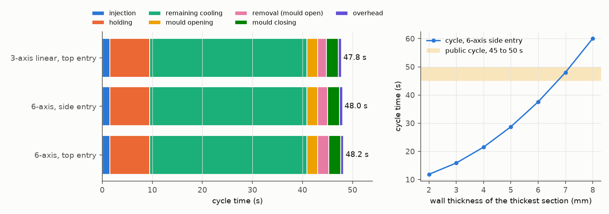
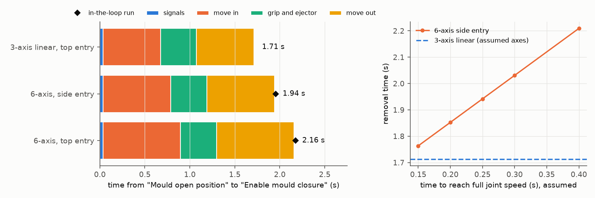
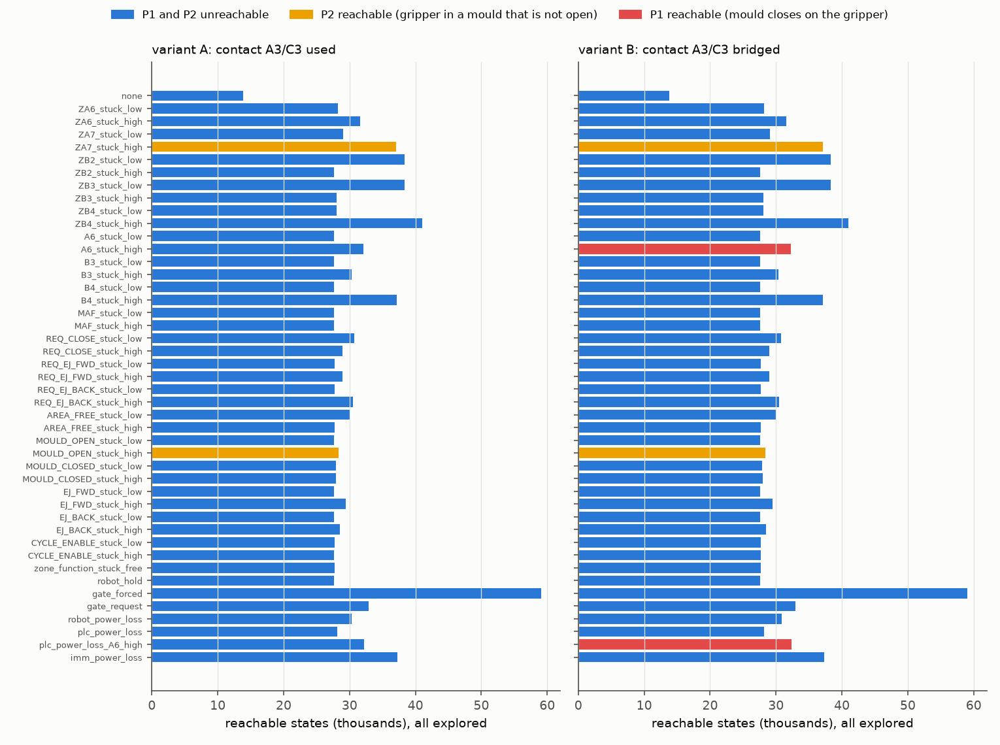
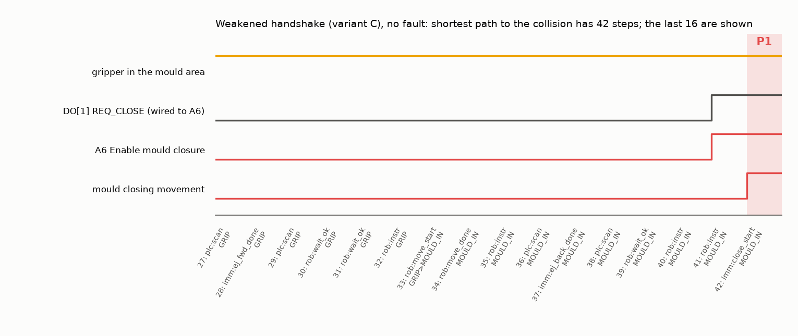
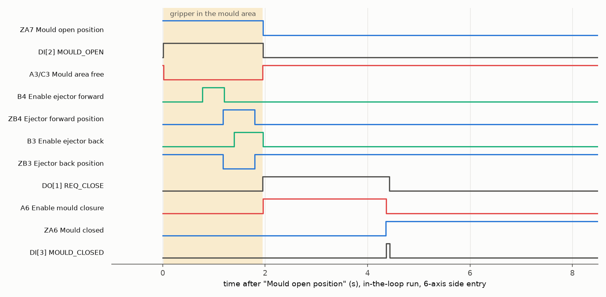

# Injection moulding cell with a 6-axis unloading robot: mould-open window and EUROMAP 67 interlock

**Systems-engineering dossier, revision 1.0 (25 Nov 2026). Simulation-only study.** Blocks marked "generated" are
written from `results/studies.json` and `config/cell.yaml` by `scripts/make_tables.py`; no result number is typed by
hand. The PLC in every run is the compiled IEC 61131-3 block (`plc/st/cell_plc.st`, matiec). The robot in every
run is the FANUC TP program file (`robot/UNLOAD_IMM.ls`), executed by the interpreter in `cell/tp.py`. The machine
is a model written from the signal descriptions of EUROMAP 67.

**Central question.** A public user report describes a door-handle moulding plant with linear robots [R1]. What
changes with a 6-axis robot: can it unload the mould inside the mould-open window without lengthening the cycle,
and which handshake between machine, robot and cell PLC makes it impossible for the mould to close on the
gripper, also under a single fault?

**Short answer.** The 6-axis robot costs a few tenths of a second per cycle against a linear robot, well under one
per cent, because cooling of the thick handle section sets the cycle. The mould cannot close on the gripper when
the machine needs two independent conditions to close: the contact "Mould area free", which follows the robot
position, and "Enable mould closure", which follows the sequence. The state-space exploration shows this for the
model, over every listed single fault. With one of the two conditions removed, one stuck signal is enough for a
collision, and the checker prints the path.

**How to read the evidence.** Every value carries a tag: **[S]** sourced (§14), **[D]** derived here (file named),
**[A]** assumed. The method follows Wasson, *System Engineering Analysis, Design, and Development*, 2nd ed.,
Wiley 2016 [W].

---

## 0. Findings (generated)

<!-- TABLE:findings -->
1. **Cooling sets the cycle, not the robot.** A 7 mm section of PA6-GF30 needs 39.4 s to cool from 280 °C melt to a mean 120 °C in an 80 °C mould (a = 0.176 mm²/s from the datasheet conductivity, density and heat capacity). That is 82 % of the 48.0 s cycle. The closed-form relation and a finite-difference solution agree: 39.37 s and 39.36 s. The model cycle falls in the public 45 to 50 s band only near 7 mm (37.6 s at 6 mm, 60.1 s at 8 mm).
2. **A 6-axis robot does lengthen the mould-open window, by a few tenths of a second.** Removal time from "Mould open position" to "Enable mould closure": 1.71 s for a 3-axis linear robot (axis data assumed), 1.94 s for the 6-axis robot entering from the side, 2.16 s from the top. The difference is 0.23 s and 0.45 s, or 0.48 % and 0.94 % of the cycle, or 7 047 and 13 674 parts per machine and year. The in-the-loop run (compiled PLC, TP program, machine model) measures 1.956 s against the 1.942 s budget.
3. **Deciding parameter for output: seconds of mould-open time.** One second costs 2.08 % of the cycle, 29 960 parts per machine and year (4 cavities, 5760 h, OEE 0.85). The 6-axis penalty grows as the wall gets thinner: 0.48 % at 7 mm, 1.47 % at 3 mm, 1.97 % at 2 mm. The joint acceleration is not published; over the assumed range (0.15 to 0.4 s to full speed) the side-entry removal time runs from 1.76 to 2.21 s. Fourteen machines at this cycle give 20.6 million mouldings a year against the public 3.5 million door-handle assemblies, a ratio of 5.9. This is a plausibility check, not a validation.
4. **The mould cannot close on the gripper: shown over the complete state space.** For the design (variant A) the checker explored 45 scenarios (no fault and 44 single faults), 1 366 810 states and 5 362 922 transitions. The state "closing movement while the gripper is in the mould area" (P1) is reachable in none of them. Without timeouts and with a PLC that is faster than the shot, all 1 125 of 1 125 states can reach the next shot; there are 0 deadlocks.
5. **What makes it impossible is two independent conditions at the machine.** The machine closes only with the contact "Mould area free" (A3/C3, from the robot position) and with "Enable mould closure" (A6, from the sequence). With the contact bridged (variant B) the cell is still safe without a fault, but 2 single faults reach P1: `A6_stuck_high`, `plc_power_loss_A6_high`. With the contact bridged, A6 wired straight from the robot and a program that requests closure before the retreat ends (variant C), the checker finds the collision without any fault in 42 steps and prints the trace. The same program inside the full design (variant D) reaches P1 in 0 states.
6. **One weaker property is not single-fault tolerant.** "The gripper is in the mould area only while the mould is at its open position" (P2) fails for 2 faults of variant A: `ZA7_stuck_high`, `MOULD_OPEN_stuck_high`. EUROMAP 67 carries "Mould open position" on one contact (ZA7). The robot can then enter a mould that is still opening. The mould does not close on it (P1 holds), but the gripper can hit the mould. A second, independent open signal or a stroke-time check would be needed; neither is implemented here.
7. **The timed run stays inside the model.** All 87 of 87 observable states of the in-the-loop run are reachable states of the explored model.
<!-- /TABLE -->

---

## 1. Need, problem space and stakeholders ([W] ch. 4–5)

The plant in [R1] makes exterior door handles from PA6-GF30 in 4-cavity moulds on 14 machines of 1800 to 5500 kN,
with linear robots and peripherals for automatic downstream finishing. The report gives a cycle of about 45 to
50 s for gas-injection handles and about 3.5 million handle assemblies a year. It does not describe the robot
interface, the cell control or any 6-axis robot. Everything about those in this study is this study's own design.

| Stakeholder | Concern |
|---|---|
| Production | cycle time and output per machine; no extra mould-open time |
| Toolroom | the mould must never close on a gripper; a mould repair stops the machine for days |
| Maintenance, setter | access to gripper, cutter and conveyor without stopping the machine longer than needed |
| Safety engineer | which functions protect persons and which only protect equipment |
| Automation engineer | a handshake that does not depend on scan times or move times |

## 2. Concept of operations ([W] ch. 5–6)

1. The machine injects, holds and cools with the mould closed. The robot waits at its start position outside the
   mould area or works downstream.
2. The mould opens. The machine reports "Mould open position". The PLC passes it to the robot.
3. The robot leaves the start position (the contact "Mould area free" opens), moves between the mould halves and
   onto the parts, switches the vacuum on and asks for the ejector. The ejector moves forward and hands the parts
   to the gripper.
4. The robot pulls the parts off, asks for the ejector to go back and retreats to the start position.
5. Back at the start position with the parts, the robot requests closure. The PLC sets "Enable mould closure".
   The machine closes and starts the next shot.
6. While the mould is closed, the robot presents the parts to the sprue cutter, places them on the conveyor nest
   and returns. The closure handshake is finished before the robot waits for the next opening.
7. Access: the operator presses the request button. The robot finishes its cycle and parks. The PLC releases the
   gate lock. After the gate is closed and reset, the cycle goes on.

## 3. Modes and states ([W] ch. 7)

| Component | States in the model |
|---|---|
| Machine (`cell/system.py`) | mould CLOSED, OPENING, OPEN, CLOSING; shot PROCESS, DONE; ejector BACK, FWD; ejector sequence done |
| PLC (`plc/st/cell_plc.st`) | S_INIT, S_MOULDING, S_OPEN, S_UNLOAD, S_CLOSE, S_ACCESS, S_FAULT, plus five latches |
| Robot (`robot/UNLOAD_IMM.ls`) | program line, position or move, digital outputs, vacuum, alarm |
| Cell | part in gripper, cutter closed, nest full, gate open |

Modes outside the model: manual and set-up operation of the machine, teaching of the robot, operation of the
machine without robot, recovery after a fault.

## 4. Requirements ([W] ch. 19–22)

Derived from EUROMAP 67 version 1.11 [R2] (paraphrased; table and contact in the source column), the scope of
EN 201 [R6] and the question.

| ID | Requirement | Source | Verified by |
|---|---|---|---|
| SR-01 | No closing movement of the mould while the gripper is in the mould area (P1), without fault and under each single fault of §8.3 | question | state space, §8.4 |
| SR-02 | The gripper is in the mould area only while the mould is at its open position (P2) | question | state space, §8.4: holds without fault, fails for two faults |
| SR-03 | With the contact "Mould area free" open, the machine neither opens nor closes the mould | [R2] Table 2, A3/C3 | machine model; state space |
| SR-04 | The contact "Mould area free" opens when the robot leaves its start position | [R2] Table 2, A3/C3 | zone rule in `System.inside`; `tests/test_interfaces.py` (the program never writes the zone signal) |
| SR-05 | "Enable mould closure" stays HIGH until "Mould closed"; if it goes LOW the closing stops | [R2] Table 2, A6 | PLC state S_CLOSE; machine model |
| SR-06 | "Enable mould closure" is not combined by a logical OR with any other signal | [R2] Table 2, A6 | `qA6_EnableMouldClosure` is one AND term in the ST block |
| SR-07 | "Enable ejector forward" and "Enable ejector back" stay HIGH until the machine reports the position | [R2] Table 2, B3, B4 | timing diagram, §8.5 |
| SR-08 | Safety signals on two channels: emergency stop both ways, safety devices of machine | [R2] 2.3, Table 1 | not modelled as circuits; see §9 |
| SR-09 | The removal must not lengthen the cycle by more than 1 % against the linear robot | this study [A] | §7 |
| SR-10 | The handshake must not depend on scan time or move time | this study | free interleaving in the model, §8.1 |
| SR-11 | The closure handshake cannot deadlock | this study | §8.4, liveness |

## 5. Architecture and interfaces ([W] ch. 26–27)

```
            EUROMAP 67 logical signals                    robot I/O
 MACHINE  <----------------------------->  CELL PLC  <--------------------->  ROBOT (TP program)
   |  ZA6 ZA7 ZB2 ZB3 ZB4 ->   <- A6 B2 B3 B4         DI[1..9] <-   -> DO[1..7], DO[10]
   |
   |  contact signals, not through the standard PLC
   +<------ A3/C3 Mould area free ------------------------------------------  robot zone function
   +------- ZA3/ZC3, ZA4/ZC4 Safety devices of machine --------------------->  robot safety input
   +<-----> ZA1/ZC1, ZA2/ZC2 and A1/C1, A2/C2 emergency stop, two channels -->
```

Design decisions:

- **Two independent conditions for closing.** The machine evaluates A3/C3 and A6. A3/C3 comes from the robot
  position. A6 comes from the sequence: the robot requests closure only at the start position with the part in the
  gripper, and the PLC sets A6 only in state S_CLOSE.
- **The zone signal is not a program output.** DO[10] and the contact are set by the controller's zone function.
  The program only reads DO[10].
- **Four-phase closure handshake.** REQ_CLOSE on → A6 on → "Mould closed" → MOULD_CLOSED on → REQ_CLOSE off →
  MOULD_CLOSED off. The PLC passes the next "mould open" to the robot only after the last phase. No step relies on
  a pulse length.
- **Downstream runs while the mould is closed.** The robot holds REQ_CLOSE during the cutter and conveyor moves
  and finishes the handshake afterwards. This costs no cycle time.

Signals of the model (generated; names of the EUROMAP 67 signals as in [R2]):

<!-- TABLE:signals -->
| Signal in the model | Contact or robot I/O | From | To | Meaning |
|---|---|---|---|---|
| ZA6 | ZA6 | IMM | PLC | Mould closed |
| ZA7 | ZA7 | IMM | PLC | Mould open position |
| ZB2 | ZB2 | IMM | PLC | Enable operation with handling device / robot |
| ZB3 | ZB3 | IMM | PLC | Ejector back position |
| ZB4 | ZB4 | IMM | PLC | Ejector forward position |
| A6 | A6 | PLC | IMM | Enable mould closure |
| B3 | B3 | PLC | IMM | Enable ejector back |
| B4 | B4 | PLC | IMM | Enable ejector forward |
| MAF | A3/C3 | ROBOT | IMM | Mould area free (one switch contact) |
| REQ_CLOSE | DO[1] | ROBOT | PLC | request Enable mould closure |
| REQ_EJ_FWD | DO[2] | ROBOT | PLC | request Enable ejector forward |
| REQ_EJ_BACK | DO[3] | ROBOT | PLC | request Enable ejector back |
| AREA_FREE | DO[10] | ROBOT | PLC | monitoring copy of Mould area free |
| MOULD_OPEN | DI[2] | PLC | ROBOT | mould open, enter |
| MOULD_CLOSED | DI[3] | PLC | ROBOT | closure acknowledged |
| EJ_FWD | DI[4] | PLC | ROBOT | ejector forward |
| EJ_BACK | DI[5] | PLC | ROBOT | ejector back |
| CYCLE_ENABLE | DI[8] | PLC | ROBOT | next cycle allowed |
<!-- /TABLE -->

Not used: "Reject" (ZA5, optional), "Intermediate mould opening position" (ZA8, optional), "Enable full mould
opening" (A7, optional), the core-puller signals (optional). "Enable operation with handling device / robot" (ZB2)
is read by the PLC and is constant HIGH in the machine model. "Handling device / robot operation mode" (B2) is
held LOW (operation with the machine).

## 6. Design, budgets and margins ([W] ch. 31)

### 6.1 Inputs (generated from `config/cell.yaml`)

<!-- TABLE:inputs -->
| Input | Value | Tag |
|---|---|---|
| Machines, clamping force | 14, 1800 to 5500 kN | [S] R1 |
| Cavities per mould | 4 | [S] R1 |
| Public cycle time | 45 to 50 s | [S] R1 |
| Public output | 3.5 million assemblies a year | [S] R1 |
| Material | PA6-GF30: 1360 kg/m³, 0.36 W/(m K), 1500 J/(kg K) | [S] R4 |
| Melt / mould temperature | 280 / 80 °C | [S] R4 |
| Mean demoulding temperature | 120 °C (range 100 to 160) | [A] |
| Thickest section | 7 mm | [A], set to meet the public cycle |
| Injection, holding, opening, closing, ejector | 1.5, 8.0, 2.2, 2.4, 0.4 s | [A] |
| 6-axis robot | FANUC M-20iD/25: 25 kg, 1831 mm, J1 to J6 210, 210, 265, 420, 420, 720 °/s | [S] R5 |
| Time to full joint speed | 0.25 s (range 0.15 to 0.4) | [A] |
| Link lengths, programmed linear speed | 840 + 990 mm, 2000 mm/s | [A] |
| Linear robot axes | vertical 3000 mm/s, 20000 mm/s² | [A] |
| PLC scan, robot I/O scan | 10 ms, 8 ms | [A] |
| Production time, OEE | 5760 h a year, 0.85 | [A] |
<!-- /TABLE -->

### 6.2 Cooling and cycle (`cell/cooling.py`)

A plate of thickness s at melt temperature T_M between walls at T_W cools by conduction. The first term of the
series solution gives the textbook relation of Menges and Mohren, printed in its centre-line form in [R3]:

    t = s² / (π² a) · ln( k · (T_M − T_W) / (T_E − T_W) ),   k = 4/π (centre line at T_E),  k = 8/π² (mean at T_E)

The mean form follows from the same series. The effective thermal diffusivity is a = λ / (ρ c_p) from the datasheet
[R4] **[D]**. `plate_fd` solves the same plate with finite differences; the tests compare both forms.

Cycle of the 6-axis side-entry cell and sensitivities (generated):

<!-- TABLE:cycle -->
| Phase | Time (s) | Share |
|---|---|---|
| injection | 1.50 | 3.1 % |
| holding | 8.00 | 16.7 % |
| remaining cooling | 31.37 | 65.3 % |
| mould opening | 2.20 | 4.6 % |
| removal (mould open) | 1.94 | 4.0 % |
| mould closing | 2.40 | 5.0 % |
| overhead | 0.60 | 1.2 % |
| **cycle** | **48.01** | |

| Wall (mm) | 3 | 4 | 5 | 6 | 7 | 8 |
|---|---|---|---|---|---|---|
| Cooling time (s) | 7.2 | 12.9 | 20.1 | 28.9 | 39.4 | 51.4 |

| Mean demoulding temperature (°C) | 100 | 110 | 120 | 140 | 160 |
|---|---|---|---|---|---|
| Cooling time at the base wall (s) | 58.9 | 47.5 | 39.4 | 28.0 | 19.9 |

Centre-line criterion instead of the mean: 52.1 s (finite differences 52.1 s).
<!-- /TABLE -->

The mould-open time enters the cycle one to one. Its effect on output is in finding 3.



### 6.3 Robot removal time (`cell/motion.py`)

Joint speeds are from the product page [R5]. Each joint reaches its full speed in the assumed acceleration time, so
its acceleration limit is speed / time **[A]**. A joint move runs one trapezoid per joint and takes the slowest. A
linear move limits path speed and acceleration so that no joint exceeds its limits anywhere on the line. The arm is
a two-link model with assumed link lengths **[A]**; J5 holds the tool pitch and J6 the tool yaw. Every move stops at
its end point.

Removal time = signal latency + move in + max(vacuum, ejector forward) + move out, counted from "Mould open
position" to "Enable mould closure". The ejector returns during the retreat.



Budget against the in-the-loop run (generated):

<!-- TABLE:timed -->
| Layout | Removal, budget (s) | Removal, in the loop (s) | Cycle, budget (s) | Cycle, in the loop (s) | Robot alarm | P1 or P2 seen |
|---|---|---|---|---|---|---|
| 6-axis, side entry | 1.942 | 1.956 | 48.01 | 48.03 | no | no |
| 6-axis, top entry | 2.159 | 2.176 | 48.23 | 48.25 | no | no |
<!-- /TABLE -->

## 7. Trade study: analysis of alternatives ([W] ch. 32)

<!-- TABLE:alternatives -->
| Alternative | Move in (s) | Grip and ejector (s) | Move out (s) | Removal (s) | Cycle (s) | Cycle vs linear | Parts per machine and year | Robot idle per cycle (s) | Floor space, assumed (m²) | Downstream |
|---|---|---|---|---|---|---|---|---|---|---|
| 3-axis linear, top entry | 0.64 | 0.40 | 0.64 | 1.71 | 47.78 | +0.00 % | 1 475 467 | 42.9 | 2.5 | sprue cut in the gripper, drop on a conveyor in one orientation |
| 6-axis, side entry | 0.75 | 0.40 | 0.75 | 1.94 | 48.01 | +0.48 % | 1 468 421 | 42.8 | 9 | sprue cut, gate check, place on fixture or conveyor in any orientation |
| 6-axis, top entry | 0.86 | 0.40 | 0.86 | 2.16 | 48.23 | +0.94 % | 1 461 794 | 42.7 | 6 | as side entry; longer path over the guard |
<!-- /TABLE -->

Reading: the linear robot is fastest in the mould and needs least floor space, but it can only carry the part to
one drop position in one orientation. The 6-axis robot is slower in the mould by a few tenths of a second and
needs a fenced floor area, but it is idle for most of the cycle and can present the part to a cutter, a camera or
a fixture in any orientation. SR-09 is met by both 6-axis layouts at this wall thickness. It would not be met by a
thin-walled part with a short cycle (finding 3). The floor areas and the linear robot's axis data are assumptions,
so this table ranks; it does not size.

## 8. Modelling and simulation

### 8.1 The model (`cell/system.py`)

The cell is a set of communicating state machines at signal level. One global step is one of: a machine event,
one robot instruction or move event, one PLC scan, one cell-device event, one operator action, or the activation of
the scenario's fault. The order is free. A result therefore does not depend on a scan time, a move time or a
machine time.

- The **robot** is the LS file. `cell/tp.py` executes one instruction per step. A WAIT with TIMEOUT may time out
  whenever its condition is false.
- The **PLC** is the compiled block. Its whole memory is saved and restored around each scan, so one scan is a
  pure function of state and inputs. The closing watchdog may expire at any scan from the second one on, or never.
- The **machine** follows [R2]: it opens and closes only with the contact "Mould area free" closed and the safety
  devices operative, closes only with "Enable mould closure" HIGH after a complete ejector sequence, and stops a
  closing stroke when a condition is lost.
- The gripper is **in the mould area** when the robot is at a mould position or on a move that starts or ends at
  one.

### 8.2 Properties

- **P1**: the mould makes a closing movement while the gripper is in the mould area.
- **P2**: the gripper is in the mould area while the mould is not at its open position.
- **Liveness**: from every reachable state the next shot can still be reached. This is checked without timeouts
  and with one timing assumption: the shot does not end before the PLC has settled on the current signals.
  No P1 or P2 result uses this assumption.

Both hazards are evaluated on the physical state, not on the possibly faulty signals.

### 8.3 Fault list and results per scenario (generated)

Each scenario is the fault-free cell plus at most one fault. The fault becomes active at any moment and stays
(the robot hold may also end). A signal stuck at its present level also covers a lost edge. Columns A and B show
which property becomes reachable; "–" means neither.

<!-- TABLE:faults -->
| Scenario | What happens | States (A) | A | B |
|---|---|---|---|---|
| `none` | no fault | 13 819 | – | – |
| `ZA6_stuck_low` | Mould closed (ZA6) stuck LOW; also covers a lost edge | 28 216 | – | – |
| `ZA6_stuck_high` | Mould closed (ZA6) stuck HIGH; also covers a lost edge | 31 577 | – | – |
| `ZA7_stuck_low` | Mould open position (ZA7) stuck LOW; also covers a lost edge | 29 064 | – | – |
| `ZA7_stuck_high` | Mould open position (ZA7) stuck HIGH; also covers a lost edge | 37 090 |  P2 |  P2 |
| `ZB2_stuck_low` | Enable operation with handling device / robot (ZB2) stuck LOW; also covers a lost edge | 38 326 | – | – |
| `ZB2_stuck_high` | Enable operation with handling device / robot (ZB2) stuck HIGH; also covers a lost edge | 27 638 | – | – |
| `ZB3_stuck_low` | Ejector back position (ZB3) stuck LOW; also covers a lost edge | 38 343 | – | – |
| `ZB3_stuck_high` | Ejector back position (ZB3) stuck HIGH; also covers a lost edge | 28 040 | – | – |
| `ZB4_stuck_low` | Ejector forward position (ZB4) stuck LOW; also covers a lost edge | 28 040 | – | – |
| `ZB4_stuck_high` | Ejector forward position (ZB4) stuck HIGH; also covers a lost edge | 41 007 | – | – |
| `A6_stuck_low` | Enable mould closure (A6) stuck LOW; also covers a lost edge | 27 638 | – | – |
| `A6_stuck_high` | Enable mould closure (A6) stuck HIGH; also covers a lost edge | 32 114 | – | **P1** P2 |
| `B3_stuck_low` | Enable ejector back (B3) stuck LOW; also covers a lost edge | 27 638 | – | – |
| `B3_stuck_high` | Enable ejector back (B3) stuck HIGH; also covers a lost edge | 30 340 | – | – |
| `B4_stuck_low` | Enable ejector forward (B4) stuck LOW; also covers a lost edge | 27 638 | – | – |
| `B4_stuck_high` | Enable ejector forward (B4) stuck HIGH; also covers a lost edge | 37 110 | – | – |
| `MAF_stuck_low` | Mould area free (one switch contact) (A3/C3) stuck LOW; also covers a lost edge | 27 638 | – | – |
| `MAF_stuck_high` | Mould area free (one switch contact) (A3/C3) stuck HIGH; also covers a lost edge | 27 638 | – | – |
| `REQ_CLOSE_stuck_low` | request Enable mould closure (DO[1]) stuck LOW; also covers a lost edge | 30 756 | – | – |
| `REQ_CLOSE_stuck_high` | request Enable mould closure (DO[1]) stuck HIGH; also covers a lost edge | 28 934 | – | – |
| `REQ_EJ_FWD_stuck_low` | request Enable ejector forward (DO[2]) stuck LOW; also covers a lost edge | 27 692 | – | – |
| `REQ_EJ_FWD_stuck_high` | request Enable ejector forward (DO[2]) stuck HIGH; also covers a lost edge | 28 934 | – | – |
| `REQ_EJ_BACK_stuck_low` | request Enable ejector back (DO[3]) stuck LOW; also covers a lost edge | 27 692 | – | – |
| `REQ_EJ_BACK_stuck_high` | request Enable ejector back (DO[3]) stuck HIGH; also covers a lost edge | 30 482 | – | – |
| `AREA_FREE_stuck_low` | monitoring copy of Mould area free (DO[10]) stuck LOW; also covers a lost edge | 29 987 | – | – |
| `AREA_FREE_stuck_high` | monitoring copy of Mould area free (DO[10]) stuck HIGH; also covers a lost edge | 27 692 | – | – |
| `MOULD_OPEN_stuck_low` | mould open, enter (DI[2]) stuck LOW; also covers a lost edge | 27 638 | – | – |
| `MOULD_OPEN_stuck_high` | mould open, enter (DI[2]) stuck HIGH; also covers a lost edge | 28 364 |  P2 |  P2 |
| `MOULD_CLOSED_stuck_low` | closure acknowledged (DI[3]) stuck LOW; also covers a lost edge | 27 888 | – | – |
| `MOULD_CLOSED_stuck_high` | closure acknowledged (DI[3]) stuck HIGH; also covers a lost edge | 27 972 | – | – |
| `EJ_FWD_stuck_low` | ejector forward (DI[4]) stuck LOW; also covers a lost edge | 27 638 | – | – |
| `EJ_FWD_stuck_high` | ejector forward (DI[4]) stuck HIGH; also covers a lost edge | 29 426 | – | – |
| `EJ_BACK_stuck_low` | ejector back (DI[5]) stuck LOW; also covers a lost edge | 27 638 | – | – |
| `EJ_BACK_stuck_high` | ejector back (DI[5]) stuck HIGH; also covers a lost edge | 28 522 | – | – |
| `CYCLE_ENABLE_stuck_low` | next cycle allowed (DI[8]) stuck LOW; also covers a lost edge | 27 728 | – | – |
| `CYCLE_ENABLE_stuck_high` | next cycle allowed (DI[8]) stuck HIGH; also covers a lost edge | 27 650 | – | – |
| `zone_function_stuck_free` | the robot zone function reports free while the gripper is inside: contact A3/C3 and DO[10] both stuck (common cause) | 27 692 | – | – |
| `robot_hold` | robot stopped mid-path or mid-program, any time, any duration | 27 638 | – | – |
| `gate_forced` | operator opens the gate without request (no guard locking) | 59 032 | – | – |
| `gate_request` | operator requests access, opens, closes, resets | 32 931 | – | – |
| `robot_power_loss` | robot controller loses power: outputs LOW, contacts open | 30 303 | – | – |
| `plc_power_loss` | cell PLC loses power: all outputs LOW | 28 163 | – | – |
| `plc_power_loss_A6_high` | cell PLC loses power and A6 goes HIGH, as EUROMAP 67 asks for a handling device that is switched off | 32 229 | – | **P1** P2 |
| `imm_power_loss` | machine loses power: no movement, outputs LOW | 37 275 | – | – |
<!-- /TABLE -->

### 8.4 Results per variant (generated)

<!-- TABLE:matrix -->
| Variant | Scenarios | States explored | Transitions | P1 reachable in | P2 reachable in |
|---|---|---|---|---|---|
| A: design: Mould area free contact used, A6 gated by the PLC, four-phase program | 45 | 1 366 810 | 5 362 922 | no scenario | `ZA7_stuck_high`, `MOULD_OPEN_stuck_high` |
| B: as A, but the Mould area free contact is bridged at the machine | 45 | 1 367 740 | 5 378 560 | `A6_stuck_high`, `plc_power_loss_A6_high` | `ZA7_stuck_high`, `A6_stuck_high`, `MOULD_OPEN_stuck_high`, `plc_power_loss_A6_high` |
| C: weakened: contact bridged, A6 straight from the robot output, early-enable program | 1 | 15 705 | 53 111 | the fault-free cell | the fault-free cell |
| D: early-enable program inside the full design (contact used, A6 gated by the PLC) | 1 | 13 759 | 46 971 | no scenario | no scenario |
<!-- /TABLE -->



What this proves and what it does not:

- Proven for the model: in every reachable state of every scenario of variant A, P1 is false. The exploration is
  complete; the checker stops only when no unvisited state is left.
- Variant B shows why the contact matters. The sequence alone is safe without a fault. One output stuck HIGH
  breaks it. EUROMAP 67 asks for "Enable mould closure" HIGH when the handling device is switched off [R2], so a
  dead PLC with a correctly wired A6 gives the same case.
- Variant C is the deliberately weakened handshake. The trace is in `results/counterexamples.txt` and below.
- Variant D shows that the program error of variant C alone does not reach P1 in the full design.
- P2 is a real limit of the design (finding 6).
- Not in the model: time. A real mould has a stopping distance. P1 says that no closing movement is commanded
  with the gripper inside; it does not say how far a moving platen travels after the contact opens. P2 is the
  property that keeps the robot out of a moving mould, and it has the limit above.



### 8.5 Timed in-the-loop run (`cell/loop.py`)

The timed run uses the same transition function and only decides when each step happens: machine and device
events after their duration, robot moves after the move time of §6.3, PLC scans and robot I/O scans at their
periods. The timing diagram is from the last of the measured cycles.



Agreement with the model: every observable state of the timed run (machine, robot, PLC outputs and state, cell
devices) is in the reachable set of variant A without fault (finding 7; `tests/test_model.py`).

## 9. Machine safety view

Sources read: EUROMAP 67 [R2], the public preview of EN 201:2009 (scope and contents) [R6], a public overview of
EN ISO 13849-1 terms [R7], a public research report on safe robot systems [R8] and a public summary of the risk
graph [R9]. EN 201, EN ISO 10218-2 and EN ISO 13849-1 themselves are paywalled and were **not** read. A real design
needs the standards, a risk assessment for the actual cell and a validated safety controller.

**Which functions are safety functions here, and which are process interlocks.**

| Function | Protects | Kind | Carried by |
|---|---|---|---|
| Emergency stop, machine ↔ robot | persons | safety function | two contact channels each way [R2] |
| Stop of hazardous robot movement when a machine guard is open | persons | safety function | "Safety devices of machine", two channels [R2]; [R2] says the risk assessment for robot movements mostly requires this redundancy |
| Stop of robot and mould movement when the cell gate is open; guard locking | persons | safety function | gate switch and lock on a safety controller (outside this repository) |
| Guards of the mould area on the machine | persons | safety function of the machine | EN 201 covers the machine and its interaction with ancillary equipment [R6] |
| No mould movement with the robot in the mould area ("Mould area free") | mould, gripper, robot; persons only indirectly | interlock on one switch contact in [R2] | A3/C3 |
| "Enable mould closure", ejector enables, mould open to the robot | process, equipment | process interlock | logical signals through the standard PLC |
| Closing watchdog, sensor plausibility, sequence faults | process | process interlock | standard PLC |

**Required performance level for the gate function.** With the risk-graph parameters as defined in [R7]: severity
S2 (serious, normally irreversible: crushing between mould halves or by the robot), exposure F1 (access on request,
a few times per shift) and avoidance P2 (scarcely possible at production speeds), the summary table in [R9] gives
**PLr = d**. With frequent access (F2) it gives PLr = e. [R9] states that it has not been checked against the
standard, so this is an estimate to be repeated with EN ISO 13849-1 itself. For robot systems, [R8] reports that
ISO 10218-2:2011 asks for PL d for the safety-related parts of the control system and describes category 3 as
"single fault does not lead to a hazard".

**"Mould area free".** In EUROMAP 67 version 1.11 this signal is one switch contact (A3/C3); the neighbouring
contacts A4/C4 are reserved. One contact is one channel. If the risk assessment of a real cell credits "Mould
area free" with protecting a person, for example when someone can reach between the mould halves from the robot
side, one contact cannot give a category 3 structure on its own. The second channel in this design is diverse:
the sequence condition A6. The exploration shows that the pair tolerates each single fault of the list for P1.
It does not give a performance level: no failure rates, diagnostic coverage or common-cause analysis were done,
and A6 runs through a standard PLC. The zone function that drives the contact must be safety-rated in a real cell
(a safety-rated position check with safe outputs); the scenario `zone_function_stuck_free` shows what the sequence
still covers when it fails.

**Relation to the standards.** EN 201 is a type C standard for injection moulding machines and specifies the
safety requirements for the interaction between the machine and ancillary equipment [R6]. [R2] refers to EN 201
for the safety devices of the mould area. EN ISO 10218-2 covers the integration of robot systems; only the
statements in [R8] were read. A web search during this work indicated that EN 201:2009 has been replaced by
EN ISO 20430; this was not checked on a primary source.

## 10. Reliability: FMEA ([W] ch. 34)

Effects are the checker results of §8.3 for variant A.

| Item, failure | Effect in the model | Covered by |
|---|---|---|
| A6 stuck HIGH (output or relay) | no P1: the contact A3/C3 blocks closing while the gripper is inside | A3/C3; in variant B this fault reaches P1 |
| A6 stuck LOW | the mould does not close; the cycle stops | availability only |
| Contact A3/C3 stuck closed | no P1: A6 comes only after the retreat | sequence (PLC and program) |
| Zone function reports free while inside (contact and DO[10]) | no P1: the program requests closure only after the retreat move has ended | program sequence |
| Robot output REQ_CLOSE stuck HIGH | no P1: the PLC sets A6 only in S_CLOSE with the area free | PLC gating, A3/C3 |
| "Mould open position" stuck HIGH (ZA7 or robot DI[2]) | **P2 reachable**: the robot can enter a mould that is not open | not covered; second signal or stroke-time check needed |
| "Mould closed" stuck or lost | no P1; the handshake stops | four-phase handshake |
| Robot stopped mid-path | no P1 and no P2: the contact stays open, nothing closes | A3/C3 |
| Gate opened without request | no P1 and no P2: robot and mould movement stop; the PLC goes to fault | safety circuit (modelled as an ideal stop) |
| Robot controller without power | no P1: the contact opens | A3/C3 de-energised open **[A]** |
| PLC without power, A6 LOW or HIGH | no P1 | A3/C3; in variant B the HIGH case reaches P1 |
| Machine without power | no movement | – |
| Place handshake loses a pulse | deadlock at the conveyor (found by the liveness check in an earlier revision of the program) | acknowledged PLACED signal, §13 |

## 11. Verification and validation ([W] ch. 13, 28)

| What | How | Where |
|---|---|---|
| Cooling relation | both forms against a finite-difference solution; scaling with s² | `tests/test_physics.py` |
| Move times | trapezoid cases, inverse kinematics against forward kinematics, reach, speed limits | `tests/test_physics.py` |
| Interfaces | every signal of the LS files is in the I/O map with the same name; the map points at real ST variables; LINE_COUNT; position registers; SCL export equals the ST source | `tests/test_interfaces.py` |
| SR-01, SR-02 | complete exploration, per scenario | `scripts/run_studies.py`, `tests/test_model.py` |
| Counter-examples | every step of the printed path is a transition of the model | `tests/test_model.py` |
| SR-11 | every state can reach the next shot; no state without successor | `tests/test_model.py` |
| Timed run | no alarm, removal time within the budget, states inside the model | `tests/test_model.py` |
| PLC watchdog | scan sequence on the compiled block | `tests/test_model.py` |

Validation against hardware: none. Done: the SCL export compiles in TIA Portal V18 with 0 errors and 0 warnings
(`results/tia_compile.txt`). Not done: compiling the LS program with the robot maker's offline
compiler, running it on a robot controller or its simulator, any test on a machine.

## 12. Assumed versus sourced, and limits

- Sourced: the scenario [R1], the signal set and its meanings [R2], material data [R4], joint speeds, reach and
  payload [R5].
- Assumed and able to change a conclusion: the wall thickness (set to meet the public cycle), the demoulding
  temperature, the joint acceleration, the link lengths, the linear robot's axis data, the layouts.
- The diffusivity uses room-temperature conductivity and heat capacity. Real effective values during cooling
  differ; the wall thickness absorbs this error because it was fitted to the public cycle.
- The public output figure counts assemblies, the model counts mouldings. The ratio in finding 3 is not a
  validation.
- The machine model is this study's reading of [R2]. A real machine may differ, for example in how it treats a
  lost enable or in what it needs before it restarts.
- The model has no time. See §8.4.
- Single faults only. Recovery after a fault is manual and outside the model.

## 13. Decision log

| Decision | Reason |
|---|---|
| A6 is gated by the PLC, not wired straight from the robot | variant C: with a direct wire one program error reaches P1 when the contact is bridged |
| Closure handshake in four phases | a stale "mould open" or a stale request cannot start the next step; no pulse can be missed |
| PLACED is acknowledged by the PLC (PLACE_ACK) | the liveness check found a deadlock: the robot could set and clear PLACED between two PLC scans |
| The robot re-checks MOULD_OPEN as the last instruction before the entry move | the exploration found a path where the robot entered after a gate fault and reset |
| Watchdog expiry is free in the model | a fixed small preset would hide runs with many scans in S_CLOSE |
| ST as source, SCL generated | one source of truth; the ST can be compiled and run without TIA Portal |
| The sequence state is an internal variable, copied to the output `state` at the end | a block that reads its own output gets the TIA warning "might not be initialized"; outputs are now write-only |
| P2 limit left open | a fix needs a second mould-open signal or timing, both outside the EUROMAP 67 signal set and this model |

## 14. References

- **[R1]** WITTMANN BATTENFELD user report on a door-handle moulding plant with gas-injection technology, March
  2018. https://www.wittmann-group.com/en/report-witte-automotive-group (page and linked PDF read 25 Nov 2026).
- **[R2]** EUROMAP 67, *Electrical Interface between Injection Moulding Machine and Handling Device / Robot*,
  version 1.11, May 2015.
  https://www.euromap.org/media/recommendations/67/2015/EU%2067_Ver_1.11_May2015.pdf (read 25 Nov 2026).
- **[R3]** Ş. Mihăilă, D. Chira, I. Horge, V. Muşet, "Study regarding the determination of the cooling time at the
  plastic plane-shaped products made by injection", Annals of the Oradea University, Fascicle of Management and
  Technological Engineering, vol. VI (XVI), 2007 (cooling-time relation, citing Menges and Mohren).
  https://www.imt.uoradea.ro/auo.fmte/files-2007/TCM_files/Stefan_Mihaila_1.pdf
- **[R4]** BASF, product information Ultramid B3WG6 (PA6-GF30), edition 09/2026: density, thermal conductivity,
  specific heat capacity, melt and mould temperature. https://download.basf.com (product information PDF).
- **[R5]** FANUC America, product page M-20iD/25: payload, reach, axis speeds.
  https://www.fanucamerica.com/products/robot/m-20id-25
- **[R6]** EN 201:2009, *Plastics and rubber machines – Injection moulding machines – Safety requirements*. Only
  the public preview (title, contents, introduction, scope) was read:
  https://cdn.standards.iteh.ai/samples/29394/3ee200248bdc40e4afe7802f944ce8ee/SIST-EN-201-2009.pdf
- **[R7]** Pilz, poster "Standards Functional Safety and Risk Assessment: EN ISO 12100, ISO 13849 and EN IEC
  62061", 2025 (definitions of S, F, P). https://www.pilz.com/download/open/Pos_Functional_safety_1003920-EN-06.pdf
- **[R8]** T. Malm, *Guidelines to make safe industrial robot systems*, VTT research report VTT-R-01109-17, 2017.
  https://sarjaweb.vtt.fi/julkaisut/muut/2017/VTT-R-01109-17.pdf
- **[R9]** Public summary page on ISO 13849-1 (risk-graph table). The page states that it is not verified against
  the standard. https://kyawminthu20.github.io/Control-System-Tools/standards/functional-safety/iso-13849-1
- **[W]** C. S. Wasson, *System Engineering Analysis, Design, and Development*, 2nd ed., Wiley, 2016.
- Cited by number only, not read: EN ISO 13849-1, EN ISO 10218-2, EN ISO 20430.
