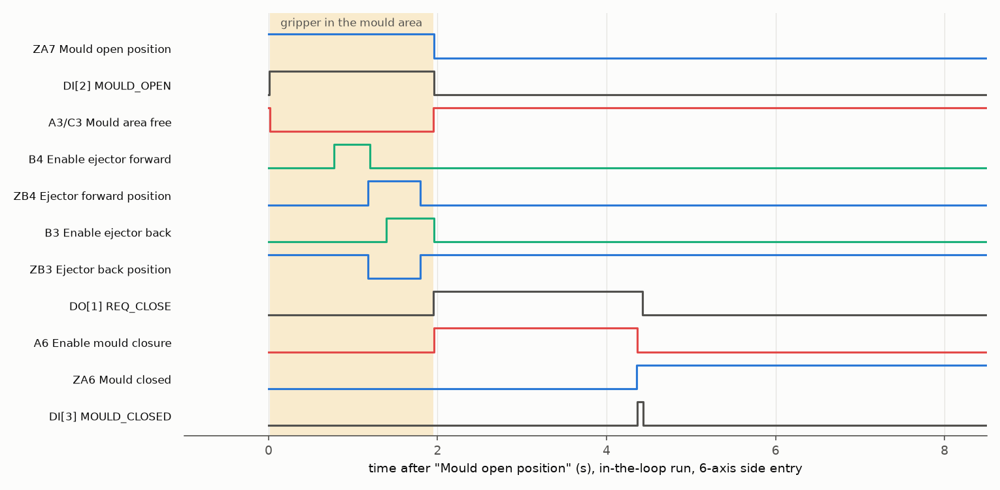
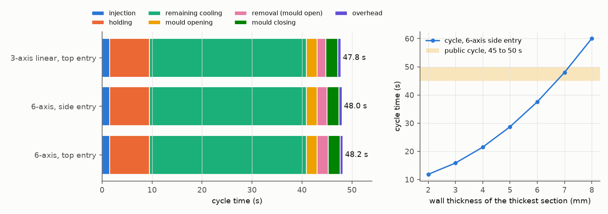
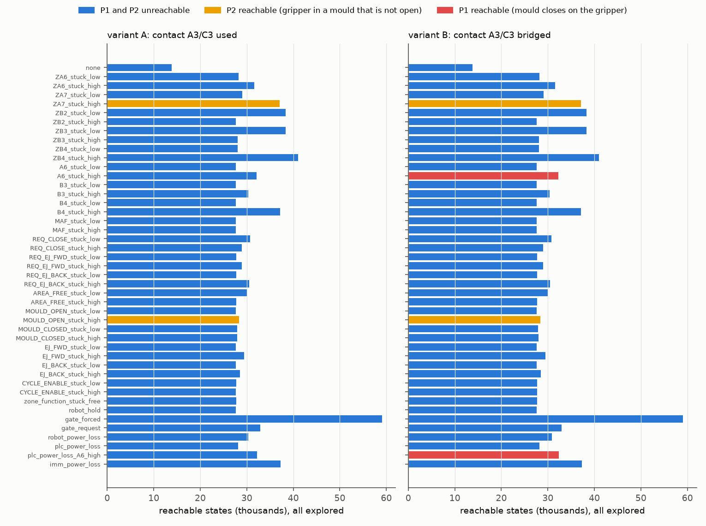
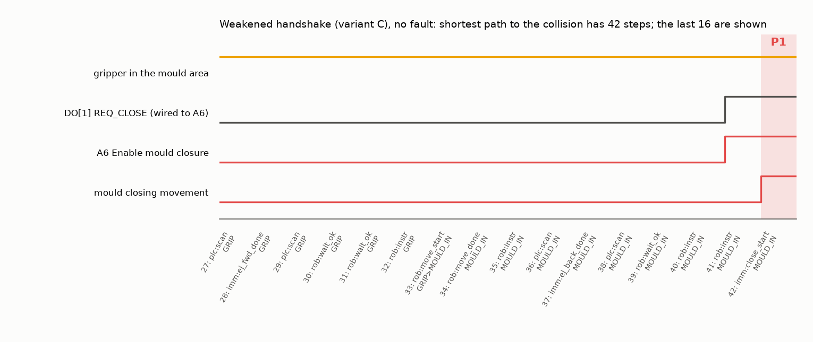

# Injection moulding cell with a 6-axis unloading robot: mould-open window and EUROMAP 67 interlock

**Simulation-only study.** No machine, robot or PLC was used. The machine is a model, the robot kinematics are
simplified, and several inputs are assumptions (listed below and tagged in the dossier). The PLC code in this
repository is standard code and is not a safety function.

**Question.** A cell moulds exterior door-handle parts. A robot enters the open mould, takes the parts, the mould
closes for the next shot, and the robot passes the parts to sprue cutting and a conveyor. A public user report
describes such a plant: 14 injection moulding machines of 1800 to 5500 kN with linear robots, 4-cavity moulds,
PA6-GF30 handles, cycles of 45 to 50 s and about 3.5 million handle assemblies a year ([R1](DOSSIER.md#14-references)).
The report names linear robots. This study asks what changes with a 6-axis robot:
can it unload the mould inside the mould-open window without lengthening the cycle, and which handshake between
machine, robot and cell PLC makes it impossible for the mould to close on the gripper, also under a single fault?

The study runs cooling physics → cycle breakdown → robot move times from joint limits → trade study →
EUROMAP 67 signal interface → PLC block (IEC 61131-3 ST, compiled) and FANUC TP program in the loop → complete
state-space exploration of machine, robot program and PLC, on a systems-engineering spine. Full report:
**[DOSSIER.md](DOSSIER.md)**.

## Findings (generated from `results/studies.json`)

<!-- TABLE:findings -->
1. **Cooling sets the cycle, not the robot.** A 7 mm section of PA6-GF30 needs 39.4 s to cool from 280 °C melt to a mean 120 °C in an 80 °C mould (a = 0.176 mm²/s from the datasheet conductivity, density and heat capacity). That is 82 % of the 48.0 s cycle. The closed-form relation and a finite-difference solution agree: 39.37 s and 39.36 s. The model cycle falls in the public 45 to 50 s band only near 7 mm (37.6 s at 6 mm, 60.1 s at 8 mm).
2. **A 6-axis robot does lengthen the mould-open window, by a few tenths of a second.** Removal time from "Mould open position" to "Enable mould closure": 1.71 s for a 3-axis linear robot (axis data assumed), 1.94 s for the 6-axis robot entering from the side, 2.16 s from the top. The difference is 0.23 s and 0.45 s, or 0.48 % and 0.94 % of the cycle, or 7 047 and 13 674 parts per machine and year. The in-the-loop run (compiled PLC, TP program, machine model) measures 1.956 s against the 1.942 s budget.
3. **Deciding parameter for output: seconds of mould-open time.** One second costs 2.08 % of the cycle, 29 960 parts per machine and year (4 cavities, 5760 h, OEE 0.85). The 6-axis penalty grows as the wall gets thinner: 0.48 % at 7 mm, 1.47 % at 3 mm, 1.97 % at 2 mm. The joint acceleration is not published; over the assumed range (0.15 to 0.4 s to full speed) the side-entry removal time runs from 1.76 to 2.21 s. Fourteen machines at this cycle give 20.6 million mouldings a year against the public 3.5 million door-handle assemblies, a ratio of 5.9. This is a plausibility check, not a validation.
4. **The mould cannot close on the gripper: shown over the complete state space.** For the design (variant A) the checker explored 45 scenarios (no fault and 44 single faults), 1 366 810 states and 5 362 922 transitions. The state "closing movement while the gripper is in the mould area" (P1) is reachable in none of them. Without timeouts and with a PLC that is faster than the shot, all 1 125 of 1 125 states can reach the next shot; there are 0 deadlocks.
5. **What makes it impossible is two independent conditions at the machine.** The machine closes only with the contact "Mould area free" (A3/C3, from the robot position) and with "Enable mould closure" (A6, from the sequence). With the contact bridged (variant B) the cell is still safe without a fault, but 2 single faults reach P1: `A6_stuck_high`, `plc_power_loss_A6_high`. With the contact bridged, A6 wired straight from the robot and a program that requests closure before the retreat ends (variant C), the checker finds the collision without any fault in 42 steps and prints the trace. The same program inside the full design (variant D) reaches P1 in 0 states.
6. **One weaker property is not single-fault tolerant.** "The gripper is in the mould area only while the mould is at its open position" (P2) fails for 2 faults of variant A: `ZA7_stuck_high`, `MOULD_OPEN_stuck_high`. EUROMAP 67 carries "Mould open position" on one contact (ZA7). The robot can then enter a mould that is still opening. The mould does not close on it (P1 holds), but the gripper can hit the mould. A second, independent open signal or a stroke-time check would be needed; neither is implemented here.
7. **The timed run stays inside the model.** All 87 of 87 observable states of the in-the-loop run are reachable states of the explored model.
<!-- /TABLE -->



## Trade study

<!-- TABLE:alternatives -->
| Alternative | Move in (s) | Grip and ejector (s) | Move out (s) | Removal (s) | Cycle (s) | Cycle vs linear | Parts per machine and year | Robot idle per cycle (s) | Floor space, assumed (m²) | Downstream |
|---|---|---|---|---|---|---|---|---|---|---|
| 3-axis linear, top entry | 0.64 | 0.40 | 0.64 | 1.71 | 47.78 | +0.00 % | 1 475 467 | 42.9 | 2.5 | sprue cut in the gripper, drop on a conveyor in one orientation |
| 6-axis, side entry | 0.75 | 0.40 | 0.75 | 1.94 | 48.01 | +0.48 % | 1 468 421 | 42.8 | 9 | sprue cut, gate check, place on fixture or conveyor in any orientation |
| 6-axis, top entry | 0.86 | 0.40 | 0.86 | 2.16 | 48.23 | +0.94 % | 1 461 794 | 42.7 | 6 | as side entry; longer path over the guard |
<!-- /TABLE -->

## State-space results

P1: the mould makes a closing movement while the gripper is in the mould area.
P2: the gripper is in the mould area while the mould is not at its open position.
A scenario is the fault-free cell plus at most one fault that becomes active at any moment and stays.

<!-- TABLE:matrix -->
| Variant | Scenarios | States explored | Transitions | P1 reachable in | P2 reachable in |
|---|---|---|---|---|---|
| A: design: Mould area free contact used, A6 gated by the PLC, four-phase program | 45 | 1 366 810 | 5 362 922 | no scenario | `ZA7_stuck_high`, `MOULD_OPEN_stuck_high` |
| B: as A, but the Mould area free contact is bridged at the machine | 45 | 1 367 740 | 5 378 560 | `A6_stuck_high`, `plc_power_loss_A6_high` | `ZA7_stuck_high`, `A6_stuck_high`, `MOULD_OPEN_stuck_high`, `plc_power_loss_A6_high` |
| C: weakened: contact bridged, A6 straight from the robot output, early-enable program | 1 | 15 705 | 53 111 | the fault-free cell | the fault-free cell |
| D: early-enable program inside the full design (contact used, A6 gated by the PLC) | 1 | 13 759 | 46 971 | no scenario | no scenario |
<!-- /TABLE -->

What is proven: for the model in `cell/system.py`, every reachable state of every listed scenario was visited, and
P1 holds in all of them for variant A. What is not proven: anything about a real machine. Outside the model:
stopping distances and reaction times, two faults at once, wiring errors, recovery after a fault (manual), teach
and set-up modes, core pullers, the optional intermediate mould-opening position, and the safety circuits
themselves. The fault list is in [DOSSIER.md §8](DOSSIER.md#8-modelling-and-simulation).

## Figures (all produced by `scripts/make_figures.py` from the runs)

| File | Shows |
|---|---|
| `docs/img/cycle_breakdown.png` | cycle phases for the three alternatives; cycle against wall thickness and the public band |
| `docs/img/removal_time.png` | removal-time budget per alternative, in-the-loop result, sensitivity to the assumed joint acceleration |
| `docs/img/handshake_timing.png` | timing diagram of the EUROMAP 67 handshake from the in-the-loop run |
| `docs/img/state_space.png` | reachable states per scenario for variants A and B, with the scenarios that reach P1 or P2 |
| `docs/img/counterexample.png` | counter-example trace of the weakened handshake (variant C) |







## What is in it

| Level | What | Where |
|---|---|---|
| Cycle | Plate cooling relation (mean and centre-line form), finite-difference check, cycle phases, annual output | `cell/cooling.py` |
| Robot | Trapezoidal moves from joint speed and acceleration limits, joint and linear moves, removal budget | `cell/motion.py` |
| Interface | EUROMAP 67 version 1.11 signal set used by the model | `cell/system.py` (`SIGNALS`) |
| PLC | ST function block `CELL_PLC`: EUROMAP 67 mapping, four-phase closure handshake, sprue cutter, conveyor, gate request. Compiled with matiec; TIA Portal SCL export | `plc/st/cell_plc.st`, `plc/scl/CellPlc.scl` |
| Robot program | FANUC TP program in LS format with WAIT timeouts; a weakened variant | `robot/UNLOAD_IMM.ls`, `robot/variants/`, `robot/io_map.yaml` |
| TP interpreter | Runs the LS file one instruction per step | `cell/tp.py` |
| Model | Machine, robot program, PLC and cell devices as communicating state machines; faults; variants | `cell/system.py` |
| Checker | Explicit-state breadth-first exploration, shortest counter-example, reachability of the next shot | `cell/checker.py` |
| In the loop | Timed run with the same transition function | `cell/loop.py` |
| PLC test bench | Self-checking bench for PLCSIM: seven cases replayed scan by scan against `CELL_PLC`, tables generated from the model | `plc/test/`, `cell/bench.py`, `scripts/make_testbench.py`, [docs/PLCSIM_RUN.md](docs/PLCSIM_RUN.md) |
| Results | Numbers, handshake trace, counter-example traces as text | `results/` |

## Run it

```bash
pip install -r requirements.txt
bash scripts/build_plc.sh              # needs matiec (iec2c) and gcc: Linux or WSL
python -m pytest -q
python -m scripts.run_studies          # results/studies.json, traces.json, counterexamples.txt
python -m scripts.make_figures
python -m scripts.make_tables
python plc/st_to_scl.py plc/st/cell_plc.st plc/scl/CellPlc.scl
python -m scripts.make_testbench       # plc/test, results/testbench_cases.json, docs/PLCSIM_RUN.md
```

Without the compiled controller the physics and interface tests still run; the model tests are skipped.

TIA Portal V18 (Windows, Openness), not part of CI:

```powershell
# the block alone
powershell -NoProfile -ExecutionPolicy Bypass -File scripts\tia_build.ps1 -Blocks "CellPlc" -PlcDir plc\scl
# the test project with the self-checking bench, saved as an archive for PLCSIM
powershell -NoProfile -ExecutionPolicy Bypass -File scripts\tia_build.ps1 -ReplaceMain `
    -Sources plc\scl\CellPlc.scl,plc\test\scl\TbBench.scl,plc\test\scl\DB_TestResult.scl,plc\test\scl\Main_Test.scl `
    -OutDir C:\TIA_build\plcsim -Archive C:\TIA_build\plcsim\cell38_plcsim_test.zap18 `
    -ResultFile results\tia_compile_testbench.txt
```
CI builds matiec at a pinned commit, compiles the ST code, runs all tests and the full study, asserts its key
results and checks that the SCL export matches the ST source.

## Assumptions and what was not verified

- The machine is a state machine written for this study from the EUROMAP 67 signal descriptions. No machine
  controller was tested.
- The 6-axis robot is a two-link arm with a simple wrist. Joint speeds are from the public product page; joint
  accelerations, link lengths and the programmed linear speed are assumed. Blending between moves is not credited.
- The linear robot's axis speeds and accelerations are assumed, not taken from a datasheet. The comparison with
  it is therefore indicative.
- The wall thickness was chosen so that the cycle meets the public 45 to 50 s band. The demoulding temperature is
  assumed. The thermal diffusivity is computed from room-temperature datasheet values.
- Cell layout, floor space, machine times, production hours and OEE are assumed.
- The ST code was compiled with matiec and run in the loop. The SCL export compiles in TIA Portal V18 for an
  S7-1513 with 0 errors and 0 warnings (`scripts/tia_build.ps1`, record in `results/tia_compile.txt`). The
  test project with the self-checking bench compiles there too and is saved as a project archive
  (`results/tia_compile_testbench.txt`). The bench passes against the matiec build in CI. It has not been run in
  PLCSIM or on a PLC by this repository; [docs/PLCSIM_RUN.md](docs/PLCSIM_RUN.md) says how to run it and which values
  mean pass. The LS program was run only by the interpreter in this repository. It was not
  compiled with the robot maker's offline compiler and not run on a robot controller or its simulator.
- EN 201, EN ISO 10218-2 and EN ISO 13849-1 are paywalled. They were not read; only the public sources named in
  the dossier were. A real cell needs the standards, a risk assessment and a validated safety controller.

MIT licence.
