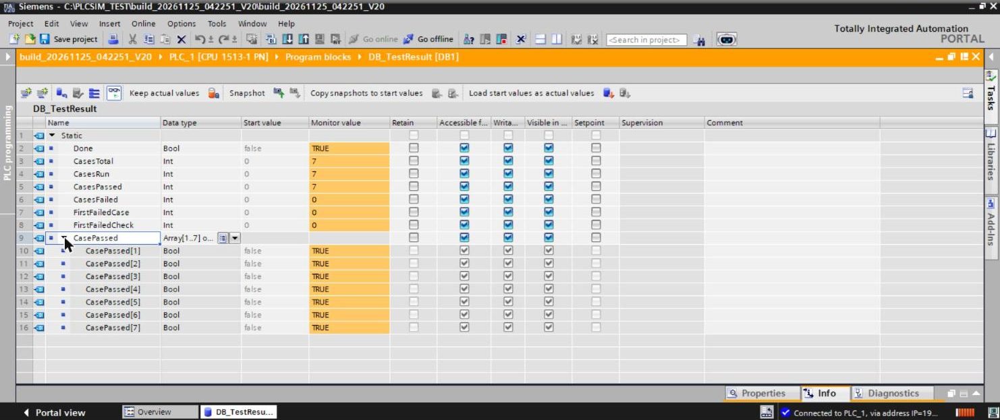
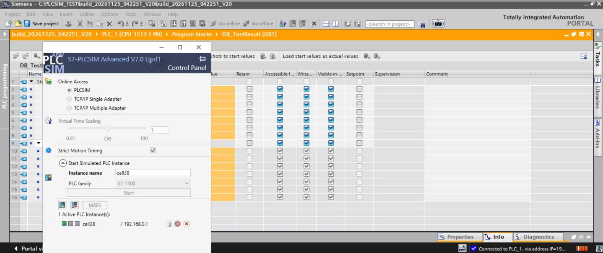

# PLCSIM run of the PLC test bench

Generated by `scripts/make_testbench.py`; the numbers below come from the model run, none is typed by hand. The
last section, "PLCSIM result", is the exception: it is the hand-written record of a run, and the generator keeps
it as it is.

**Status of the PLCSIM run: see the last section, "PLCSIM result".** Independent of that run: the bench passes when the
block is compiled with matiec (test `tests/test_bench.py`, in CI), and the test project compiles in TIA Portal V18
(`results/tia_compile_testbench.txt`).

## What the bench does

`TB_BENCH` (`plc/test/st/tb_bench.st`, TIA source `plc/test/scl/TbBench.scl`) replays 7 cases against its own
instances of `CELL_PLC`, one fresh instance per case. One call of the bench is one scan of the block under test.
For every scan it applies the recorded inputs, calls the block and compares all 16 Boolean outputs, the
state and the fault code with the recorded values. It needs no stimulus from outside.

The recorded values come from the repository's cell model (`cell/bench.py`): the machine model, the TP program
`robot/UNLOAD_IMM.ls` run by the interpreter, and the block compiled with matiec, stepped one PLC scan at a time.
The machine and the robot side are therefore present as recorded signal tables, not as SCL code. The durations
are bench values in scans (watchdog preset 25 scans), not machine times.

So a pass in PLCSIM means: the block compiled by TIA Portal for an S7-1500 gives, scan for scan, the same outputs
as the block compiled by matiec, for these 7 input sequences (1616 scans in total). It does not test
timing, real I/O or any safety function.

| Case | What it plays | Scans | Cycles closed | End state | End fault code | PLC state sequence |
|---|---|---|---|---|---|---|
| 1 `normal_cycles` | three normal cycles | 246 | 3 | S_MOULDING | none | MOULDING → OPEN → UNLOAD → CLOSE → MOULDING → OPEN → UNLOAD → CLOSE → MOULDING → OPEN → UNLOAD → CLOSE → MOULDING |
| 2 `robot_late` | robot still downstream when the mould opens again (slow sprue cutter) | 282 | 3 | S_MOULDING | none | MOULDING → OPEN → UNLOAD → CLOSE → MOULDING → OPEN → UNLOAD → CLOSE → MOULDING → OPEN → UNLOAD → CLOSE → MOULDING |
| 3 `area_free_lost_during_closing` | "Mould area free" monitoring signal lost during the closing stroke | 190 | 1 | S_FAULT | F_AREA | MOULDING → OPEN → UNLOAD → CLOSE → MOULDING → OPEN → UNLOAD → CLOSE → FAULT |
| 4 `access_on_request` | access requested, gate released, opened, closed, reset, one more cycle | 246 | 3 | S_MOULDING | none | MOULDING → OPEN → UNLOAD → CLOSE → MOULDING → ACCESS → MOULDING → OPEN → UNLOAD → CLOSE → MOULDING → OPEN → UNLOAD → CLOSE → MOULDING |
| 5 `gate_opened_and_reset` | gate opened without request while the robot waits, closed, reset, one more cycle | 246 | 3 | S_MOULDING | none | MOULDING → OPEN → UNLOAD → CLOSE → MOULDING → FAULT → INIT → MOULDING → OPEN → UNLOAD → CLOSE → MOULDING → OPEN → UNLOAD → CLOSE → MOULDING |
| 6 `conveyor_not_ready` | conveyor never indexes: the robot times out at the nest and reports a fault | 197 | 2 | S_FAULT | F_ROBOT | MOULDING → OPEN → UNLOAD → CLOSE → MOULDING → OPEN → UNLOAD → CLOSE → MOULDING → FAULT |
| 7 `closing_watchdog` | the second closing stroke never ends: the watchdog of the PLC expires | 209 | 1 | S_FAULT | F_CLOSE_TMO | MOULDING → OPEN → UNLOAD → CLOSE → MOULDING → OPEN → UNLOAD → CLOSE → FAULT |

## How to run it

1. Retrieve the archive `cell38_plcsim_test.zap18` in TIA Portal V18 (Project > Retrieve). The archive is built by
   `scripts/tia_build.ps1` (command in the README) and is not part of the repository.
2. The build script switches on "Support simulation during block compilation" before it archives. If TIA Portal
   still refuses to start the simulation, tick that box in the project properties (Protection) and compile again.
3. Select PLC_1, start simulation (PLCSIM), load, set the CPU to RUN.
4. Open the data block `DB_TestResult` and switch on monitoring. The bench runs by itself and finishes after
   1616 OB1 cycles, which is within a few seconds. It then holds its result until the next STOP to RUN.

## The values that mean pass

| Tag in `DB_TestResult` | Value for pass |
|---|---|
| `Done` | TRUE |
| `CasesTotal` | 7 |
| `CasesRun` | 7 |
| `CasesPassed` | 7 |
| `CasesFailed` | 0 |
| `FirstFailedCase` | 0 |
| `FirstFailedCheck` | 0 |
| `CasePassed[1]`, `CasePassed[2]`, `CasePassed[3]`, `CasePassed[4]`, `CasePassed[5]`, `CasePassed[6]`, `CasePassed[7]` | all TRUE |

If a case fails, `FirstFailedCase` is its number in the table above and `FirstFailedCheck` is the scan inside that
case (counted from 1) at which the outputs first differed. The remaining cases still run.

## PLCSIM result

<!-- PLCSIM-RESULT: record of the run, written by hand from the screen -->
**Run in S7-PLCSIM Advanced on 25 November 2026: 7 of 7 cases passed.** The run was done on a second
installation, not on the build machine. That installation has TIA Portal V20 and S7-PLCSIM Advanced; it has
neither TIA Portal V18 nor the standard S7-PLCSIM.

| | |
|---|---|
| Date | 2026-11-25 |
| TIA Portal | Totally Integrated Automation Portal, Version V20 Update 7; STEP 7 Professional, Version V20 Update 7 (as listed under "Installed software") |
| PLCSIM | S7-PLCSIM Advanced V7.0 Upd1 (title of its control panel). Online access "PLCSIM", one instance, PLC family S7-1500 |
| Archive | `cell38_plcsim_test.zap18`, built with TIA Portal V18 by `scripts/tia_build.ps1` |
| Upgrade | TIA Portal V20 reported "The project has a TIA Portal project version V18" and upgraded the project to V20 before it opened. The run therefore executed code generated by the V20 compiler, not by the V18 compiler of the build record |
| V20 compile, hardware (rebuild all), project as retrieved | **3 errors, 1 warning.** Errors: "If access control via access level is enabled and a higher access level (= access without login) than full access (..." (cut off on the screen); "Password for confidential PLC configuration data is not configured in the PLC."; "The PLC communication certificate cannot be configured without the password for confidential PLC configuration..." (cut off on the screen). Warning: "The S7-1500 CPU display does not contain any password protection." |
| Changed by hand in the project | PLC_1 > Properties > Protection & Security: "Protect confidential PLC configuration data" switched off, no password set; Access control from "No access (complete protection)" to "Full access (no protection)". Nothing else: no block, no table, no expected value |
| V20 compile, hardware (rebuild all), after that | 0 errors, 2 warnings: "PLC_1 does not contain a configured protection level" and "The S7-1500 CPU display does not contain any password protection." |
| V20 compile, software (rebuild all) | 0 errors, 0 warnings. All 5 blocks, `DB_TestResult` (DB1), `Main` (OB1), `CELL_PLC` (FB1), `TB_BENCH` (FB2), `TB_BENCH_DB` (DB2): "Block was successfully compiled." |
| Load | "Loading completed (errors: 0; warnings: 0)", then "PLC_1 started." The instance showed RUN (green) at 192.168.0.1 |

The build record `results/tia_compile_testbench.txt` lists a compile of the program blocks only. The hardware
configuration was compiled for the first time in this run, which is why the two protection settings had not come
up before. They belong to this simulation project only; do not copy them to a real PLC.

What differed from "How to run it":

- The V20 Project menu showed no "Retrieve" entry with no project open. Project > Open > Browse accepts the
  `.zap18` file, asks for a target directory and retrieves it.
- There is no "start simulation" path into S7-PLCSIM Advanced. The instance was created and started in the
  S7-PLCSIM Advanced control panel first. Then Online > Extended download to device, PN/IE, PG/PC interface PLCSIM;
  the search found one device, "CPUcommon", at 192.168.0.1.
- The load preview said "The loading will be performed from a simulated PLC." and needed no further choice. In
  the load results the action for "Start modules" stood at "No action" and was set to "Start module".
- TIA Portal did not ask for "Support simulation during block compilation".

Monitor values of `DB_TestResult` (monitoring on, CPU in RUN):

| Tag in `DB_TestResult` | Value for pass | Observed |
|---|---|---|
| `Done` | TRUE | TRUE |
| `CasesTotal` | 7 | 7 |
| `CasesRun` | 7 | 7 |
| `CasesPassed` | 7 | 7 |
| `CasesFailed` | 0 | 0 |
| `FirstFailedCase` | 0 | 0 |
| `FirstFailedCheck` | 0 | 0 |
| `CasePassed[1]` to `CasePassed[7]` | all TRUE | TRUE, all 7 |

Result: pass, 7 of 7 cases.

What this shows, and no more: the block `CELL_PLC`, compiled by TIA Portal V20 for the CPU 1513-1 PN and executed
by the simulated S7-1500, gave scan for scan the outputs, the state and the fault code that the matiec build gave,
for the 7 recorded input sequences. The bench is an open-loop replay: the machine and the robot are recorded
signal tables, and nothing in the simulated CPU reacts to the outputs of the block. It is not a real PLC, and it
tests no timing, no real I/O and no safety function.

`DB_TestResult` monitored online:

S7-PLCSIM Advanced control panel with the instance in RUN, in front of the monitored block:

<!-- /PLCSIM-RESULT -->
